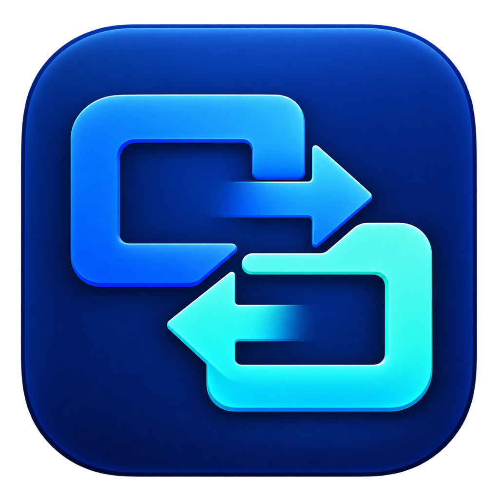
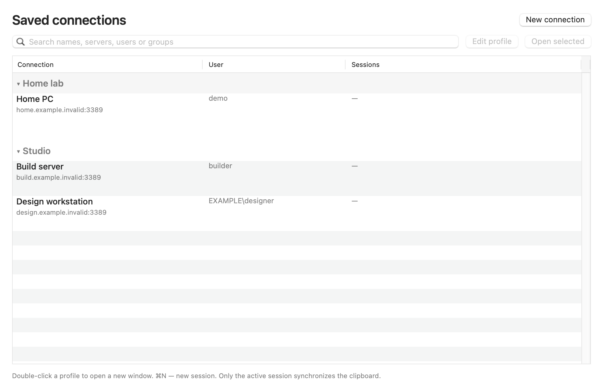
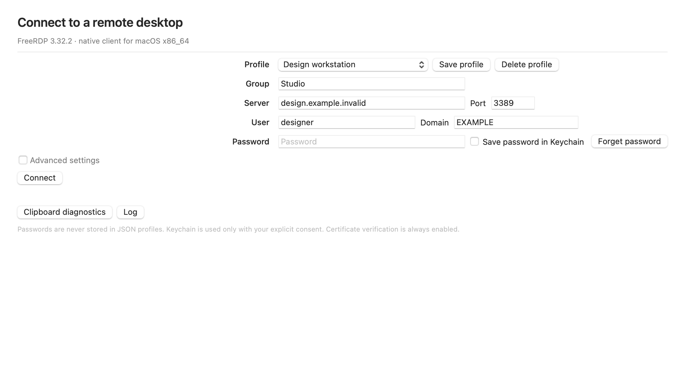

<p align="center">
  
</p>

<h1 align="center">RDP Mac</h1>
<p align="center">Independent remote desktops. A clipboard that follows your active session.</p>
<p align="center">Windows Remote Desktop client for Mac · Intel x86_64 · FreeRDP 3.32.2</p>

<p align="center">
  <a href="https://github.com/bootssoff-jpg/freeRDP-macos-x64/actions/workflows/build.yml"></a>
  <a href="LICENSE"></a>
  
  
</p>

<p align="center"><strong>English</strong> · <a href="README.ru.md">Русский</a></p>
<p align="center"><a href="https://github.com/bootssoff-jpg/freeRDP-macos-x64/releases"><strong>Downloads & release notes →</strong></a></p>

A native Intel macOS RDP client built on **FreeRDP 3.32.2**, with its own
Swift/AppKit interface, independent session windows and text clipboard sharing.
The interface is available in **English and Russian**.

## Windows Remote Desktop on a Mac

RDP Mac is a **Windows RDP client for macOS**: an Intel Mac (x86_64, macOS 12+)
connects to a Windows PC or a Windows Server over the Remote Desktop Protocol,
with NLA/CredSSP and TLS.

**Replacing Microsoft's Remote Desktop client** — “Remote Desktop Connection”
(`mstsc`), the Microsoft Remote Desktop app, or its successor “Windows App”? RDP
Mac covers the everyday case: several saved Windows computers, independent
session windows, and a reliable **two-way text clipboard** between macOS and
Windows. It is a native AppKit application, not an Electron or WebView wrapper.

- One ~6 MB DMG. No Electron, no Homebrew, no helper daemons, no telemetry.
- FreeRDP and OpenSSL are linked statically, so there is no external runtime to
  install.
- A profile manager with groups, a shared account directory and duplicate
  connection, instead of one session replacing the previous one.
- Honest scope: text clipboard only — no file or image clipboard, audio,
  multi-monitor, RemoteApp or RD Gateway yet (see [Current limits](#current-limits)).

*Also known as:* RDP client for Mac, Remote Desktop Connection for Mac, `mstsc`
for macOS, Windows App alternative, FreeRDP GUI for macOS.



*Actual AppKit views rendered offscreen with reserved `.invalid` demo hosts.
These are interface previews, not connected Windows sessions.*

## Get the app

Published binaries belong on the [Releases page](https://github.com/bootssoff-jpg/freeRDP-macos-x64/releases);
1.0.4 is the current build. Every release ships a ZIP or DMG plus
`SHA256SUMS`. You can also [build from source](docs/building.md).

| | 1.0.4 build |
|---|---|
| System | macOS 12 or newer, Intel x86_64 |
| Download formats | ZIP or DMG, plus `SHA256SUMS` |
| Runtime dependencies | Included; no Homebrew installation needed |
| Signature | Ad-hoc; **not Developer ID signed or notarized** |
| Windows verification | Automated tests pass; the live Windows checklist for the new display, quality and toolbar items is still pending |

The deployment target is 12.0; the latest local environment is macOS 15.8.1
Intel. A macOS 12 runtime check is separate from deployment-target validation.

1. Download a ZIP or DMG and its checksums from a published release.
2. Verify the selected download against `SHA256SUMS`.
3. Copy the whole **RDP Mac.app** to **Applications**; the DMG includes a shortcut.
4. An ad-hoc build may be blocked by Gatekeeper. Review the source and provenance
   before using macOS's per-app approval. The project does not disable Gatekeeper.
5. Open **New connection**, enter the server and credentials, and save a profile.

## Work with several computers

- Group profiles by project, team or location. Collapse groups or search by
  name, server, account or group.
- Double-click a profile to open a session. Select several profiles and choose
  **Open selected**. A saved Keychain password allows an immediate connection;
  otherwise each window asks for credentials.
- Use **Edit profile** to review settings without starting a connection.
- **⌘N** opens a new session window; **⌘0** opens the manager. The **Window** menu
  switches between sessions. Closing one session leaves the others running.
- The same server can have separate profiles for different accounts. Concurrent
  sign-in rules are controlled by the Windows server.



*Advanced security and display options remain available under Advanced settings.*

## Clipboard, credentials and security

Only the active session while the app is frontmost synchronizes the shared
macOS clipboard. Background sessions cannot read or overwrite it. Delayed
responses are discarded after a focus change; data requests are serialized.
If the server stops responding, diagnostics offer **Reconnect** instead of
pretending a resync can repair an unresponsive channel.

Passwords are excluded from JSON profiles and logs. Keychain storage requires
an explicit checkbox. Unknown or changed certificates require a user decision;
**Reject** is the default. Legacy TLS compatibility is an advanced, opt-in
setting that reduces security and keeps certificate approval enabled.

## Languages and shortcuts

Choose **RDP Mac → Language / Язык → System language, English or Русский**.
Changes apply after you quit and reopen the app, so active sessions are not
interrupted. Interface language does not change the Windows keyboard layout.

| Action | Shortcut |
|---|---|
| New session / connection manager | `⌘N` / `⌘0` |
| Connection settings / disconnect | `⌘,` / `⌘D` |
| Fullscreen | `⌘⌃F` |
| Ctrl+Alt+Delete | `⌘⇧Delete` |
| Send Mac → Windows / request Windows → Mac | `⌘⇧C` / `⌘⇧V` |
| Clipboard diagnostics / log | `⌘⇧B` / `⌘⇧L` |

Command maps to Ctrl by default inside a session; the setting can be changed.

## Current limits

Text clipboard only. No file/image clipboard, folder or printer redirection,
audio, camera, smart cards, IME, RD Gateway, RemoteApp, multiple monitors or
automatic reconnection. No native Apple Silicon build is included. Server
policies that disable clipboard sharing cannot be bypassed by the client.

Automated tests cover codecs, CLIPRDR, connection lifecycle, independent windows,
menu routing, language resources and bundle checks. They do not replace a
successful NLA login or a real multi-session Windows test.

## Development and documentation

```bash
make app     # pinned OpenSSL + FreeRDP + application
make test    # protocol, lifecycle and EN/RU interface tests
make dist    # ZIP + DMG + SHA256SUMS
```

- [FAQ: what RDP Mac is and is not](docs/faq.md)
- [Build from source](docs/building.md) · [Architecture](docs/architecture.md)
- [Languages and interface](docs/interface.md) · [Testing](docs/testing.md)
- [Troubleshooting](docs/troubleshooting.md) · [Release packaging](docs/releasing.md)
- [Contribute](CONTRIBUTING.md) · [Report a security issue](SECURITY.md) · [Changelog](CHANGELOG.md)

Packaging does not publish a GitHub Release or change repository visibility.
When notarization is explicitly configured, it submits an intermediate archive
to Apple. See [release packaging](docs/releasing.md).

## Credits and license

**Author:** NFreeZr.

Application code: [MIT](LICENSE). FreeRDP and OpenSSL: Apache-2.0; licenses and
[third-party notices](THIRD_PARTY_NOTICES.md) are included in the app.
RDP Mac is independent and is not endorsed by Microsoft or the FreeRDP project.
The [approved original icon](Resources/Branding/README.md) is used throughout;
no FreeRDP or Microsoft logo is used as the application's brand.
