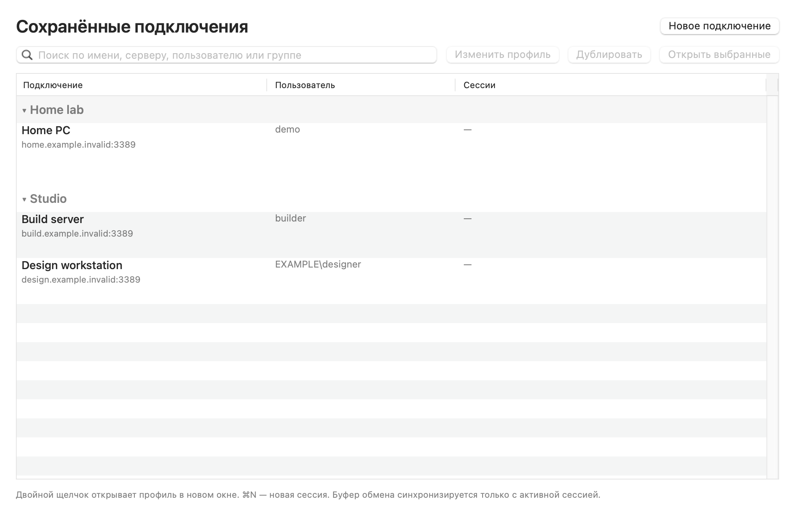
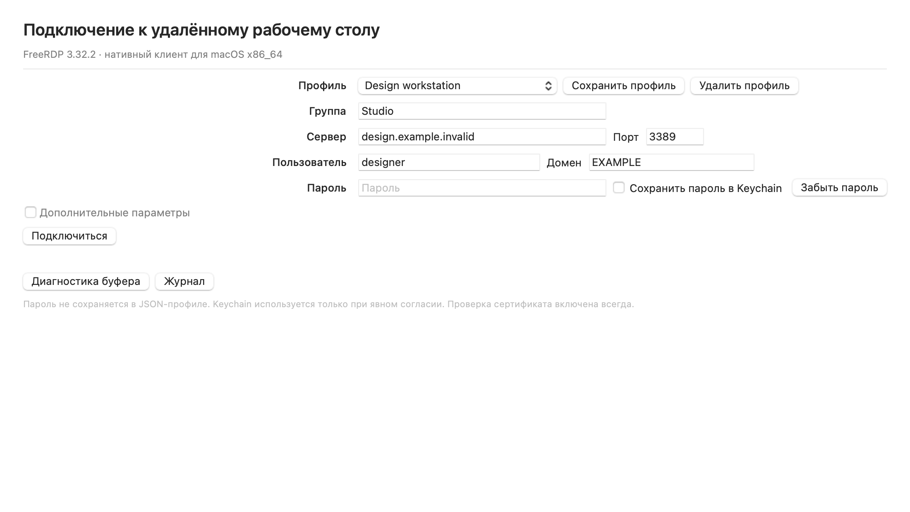

<p align="center">
  
</p>

<h1 align="center">RDP Mac</h1>
<p align="center">Независимые удалённые рабочие столы. Буфер обмена активной сессии.</p>
<p align="center">Клиент RDP для Windows на Mac · Intel x86_64 · FreeRDP 3.32.2</p>

<p align="center">
  <a href="https://github.com/bootssoff-jpg/freeRDP-macos-x64/actions/workflows/build.yml"></a>
  <a href="LICENSE"></a>
  
  
</p>

<p align="center"><a href="README.md">English</a> · <strong>Русский</strong></p>
<p align="center"><a href="https://github.com/bootssoff-jpg/freeRDP-macos-x64/releases"><strong>Скачать и посмотреть изменения →</strong></a></p>

Нативный RDP-клиент для Intel Mac на базе **FreeRDP 3.32.2**. Собственный
интерфейс Swift/AppKit, отдельные окна сессий и обмен текстом через буфер.
Интерфейс доступен **на английском и русском**.

## Удалённый рабочий стол Windows на Mac

RDP Mac — это **клиент RDP для Windows на macOS**: Intel Mac (x86_64, macOS 12+)
подключается к Windows-ПК или Windows Server по протоколу Remote Desktop с
NLA/CredSSP и TLS.

**Ищете замену клиенту Microsoft** — «Подключение к удалённому рабочему столу»
(`mstsc`), приложению Microsoft Remote Desktop или его преемнику «Windows App»?
RDP Mac закрывает повседневный сценарий: несколько сохранённых Windows-компьютеров,
независимые окна сессий и надёжный **двусторонний текстовый буфер** между macOS и
Windows. Это нативное приложение AppKit, а не обёртка на Electron или WebView.

- Один DMG ~6 МБ. Без Electron, без Homebrew, без фоновых служб и телеметрии.
- FreeRDP и OpenSSL слинкованы статически: устанавливать среду выполнения не нужно.
- Менеджер профилей с группами, общий справочник учётных записей и дублирование
  подключения — вместо одного окна, затирающего предыдущую сессию.
- Честные границы: буфер только текстовый — нет обмена файлами и изображениями,
  звука, нескольких мониторов, RemoteApp и RD Gateway (см. [Ограничения](#ограничения)).

*Также ищут как:* клиент RDP для Mac, «Подключение к удалённому рабочему столу»
для Mac, mstsc для macOS, замена Windows App, GUI для FreeRDP на macOS.



*Настоящие представления AppKit отрисованы вне экрана с демонстрационными
адресами `.invalid`. Это обзор интерфейса, без подключений к Windows.*

## Скачать приложение

Готовые сборки публикуются в [Releases](https://github.com/bootssoff-jpg/freeRDP-macos-x64/releases);
текущая сборка — 1.0.4. Каждый выпуск содержит ZIP или DMG и файл `SHA256SUMS`.
Также доступна [сборка из исходников](docs/building.md).

| | Сборка 1.0.4 |
|---|---|
| Система | macOS 12 и новее, Intel x86_64 |
| Форматы | ZIP или DMG и файл `SHA256SUMS` |
| Зависимости | Включены; Homebrew для запуска не нужен |
| Подпись | Ad-hoc; **без Developer ID и нотаризации** |
| Проверка Windows | Автотесты проходят; живой чек-лист по новым пунктам разрешения, качества и панели ещё не пройден |

Deployment target — 12.0; последняя локальная среда — macOS 15.8.1 Intel.
Проверка запуска на macOS 12 не заменяется проверкой deployment target.

1. Скачайте ZIP или DMG и контрольные суммы из опубликованного выпуска.
2. Сверьте выбранный файл с `SHA256SUMS`.
3. Скопируйте **RDP Mac.app** целиком в **Программы**; в DMG есть ссылка.
4. Gatekeeper может блокировать ad-hoc-сборку. Перед индивидуальным разрешением
   запуска средствами macOS проверьте источник и происхождение файла.
   Проект не отключает Gatekeeper.
5. Нажмите **Новое подключение**, введите сервер и учётные данные, сохраните профиль.

## Работа с несколькими компьютерами

- Объединяйте профили в группы. Сворачивайте группы или ищите по имени,
  серверу, пользователю и группе.
- Двойной щелчок открывает сессию. Выделите несколько профилей и нажмите
  **Открыть выбранные**. Если пароль разрешено сохранять и он есть в Keychain,
  подключение начинается сразу; иначе каждое окно запросит учётные данные.
- **Изменить профиль** открывает параметры без запуска подключения.
- **⌘N** — новая сессия, **⌘0** — менеджер, меню **Окно** — переключение.
  Закрытие одного окна не завершает другие сессии.
- Для одного сервера можно создать профили разных пользователей. Возможность
  одновременного входа определяется настройками Windows-сервера.



*Параметры безопасности и экрана находятся в блоке «Дополнительные параметры».*

## Буфер, пароли и безопасность

Общий буфер macOS синхронизируется только с активной сессией, пока приложение
на переднем плане. Фоновые сессии не читают и не перезаписывают его.
Запоздалые ответы после смены фокуса отбрасываются; запросы данных выполняются
последовательно. Если сервер перестал отвечать, диагностика предлагает
**Переподключиться**: обычная ресинхронизация не восстановит зависший канал.

Пароли не записываются в JSON-профили и журнал. Сохранение в Keychain требует
явной галочки. Неизвестный или изменённый сертификат требует решения
пользователя; по умолчанию выбран **отказ**. Совместимость со старым TLS —
дополнительная настройка, снижающая стойкость и сохраняющая проверку сертификата.

## Языки и сочетания клавиш

Меню **RDP Mac → Язык / Language → Как в системе, English или Русский**.
Выбор применяется после завершения и повторного запуска приложения, чтобы
не прерывать сессии. Язык интерфейса не меняет раскладку клавиатуры Windows.

| Действие | Сочетание |
|---|---|
| Новая сессия / менеджер | `⌘N` / `⌘0` |
| Параметры / отключение | `⌘,` / `⌘D` |
| Полный экран | `⌘⌃F` |
| Ctrl+Alt+Delete | `⌘⇧Delete` |
| Отправить Mac → Windows / запросить Windows → Mac | `⌘⇧C` / `⌘⇧V` |
| Диагностика буфера / журнал | `⌘⇧B` / `⌘⇧L` |

По умолчанию Command передаётся как Ctrl; это можно изменить в параметрах.

## Ограничения

Буфер передаёт только текст. Нет обмена файлами/изображениями, перенаправления
папок и принтеров, звука, камеры, смарт-карт, IME, RD Gateway, RemoteApp,
нескольких мониторов и автоматического переподключения. Нативной сборки
Apple Silicon нет. Серверный запрет буфера клиент не обходит.

Автотесты проверяют кодеки, CLIPRDR, жизненный цикл подключений, независимые
окна, команды меню, ресурсы языков и упаковку. Они не заменяют успешный вход
через NLA и проверку нескольких реальных Windows-сессий.

## Разработка и документация

```bash
make app     # закреплённые OpenSSL + FreeRDP + приложение
make test    # тесты протокола, жизненного цикла и интерфейса EN/RU
make dist    # ZIP + DMG + SHA256SUMS
```

- [FAQ: что такое RDP Mac и чего в нём нет](docs/faq.ru.md)
- [Сборка](docs/building.md) · [Архитектура](docs/architecture.md)
- [Языки и интерфейс](docs/interface.md) · [Проверки](docs/testing.md)
- [Диагностика проблем](docs/troubleshooting.md) · [Упаковка релиза](docs/releasing.md)
- [Участие](CONTRIBUTING.md) · [Безопасность](SECURITY.md) · [Изменения](CHANGELOG.md)

Упаковка не публикует GitHub Release и не меняет видимость репозитория.
При явно настроенной нотаризации промежуточный архив отправляется в Apple.
Подробности — в [инструкции выпуска](docs/releasing.md).

## Благодарности и лицензия

**Автор:** NFreeZr.

Код приложения — [MIT](LICENSE). FreeRDP и OpenSSL — Apache-2.0; лицензии и
[уведомления](THIRD_PARTY_NOTICES.md) включены в приложение.
RDP Mac — независимый проект, не одобренный Microsoft или FreeRDP.
Используется [утверждённая оригинальная иконка](Resources/Branding/README.md);
логотипы FreeRDP и Microsoft не используются как бренд приложения.
